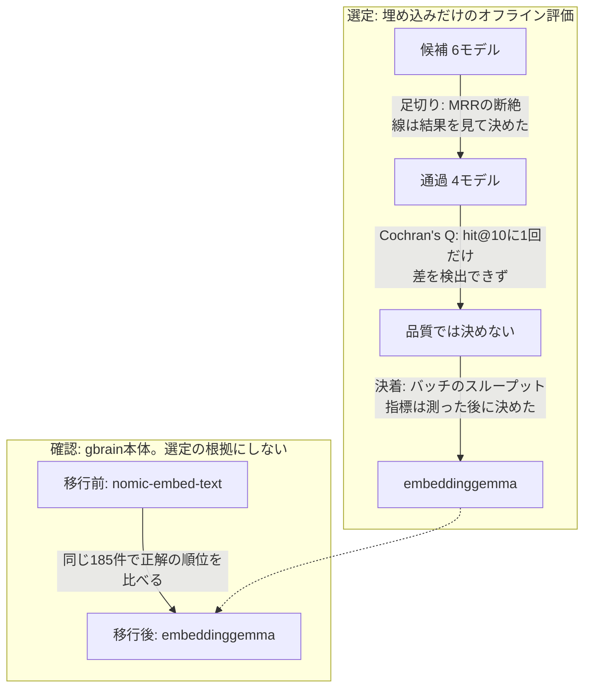
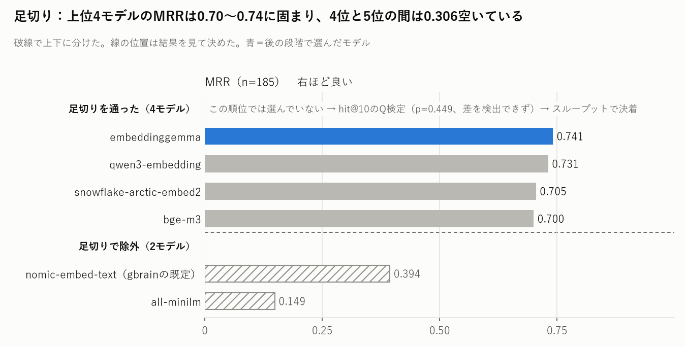
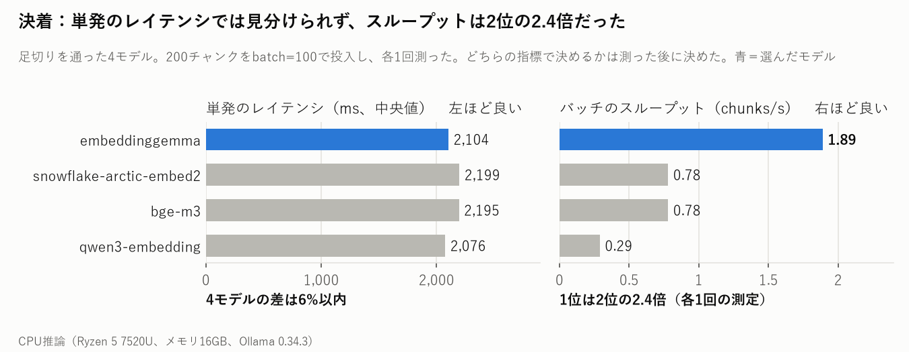

# gbrain-embedding-eval ― 埋め込みモデル6候補を検証し、品質で見分けられなかった上位4つからスループットでembeddinggemmaを選んだ

個人のナレッジ基盤[gbrain](https://github.com/garrytan/gbrain)の埋め込みモデルは、Ollama向けレシピの既定が`nomic-embed-text`である。
自分のメモ・記事521チャンクと185件のクエリで、Ollama公式の6モデルを足切りし、残りを有意差検定と速度の実測で比べて選び直した。最後に、gbrain本体で移行前後を確かめた。

解説記事: [gbrainの埋め込みモデルを個人最適化したら、検索精度がほぼ倍になった（Zenn）](https://zenn.dev/yuya0408/articles/gbrain-embedding-eval)

> embeddinggemmaが最も高精度だとは示していない。上位4モデルは品質で見分けられず、決め手は速度である。
> gbrain本体でMRRが上がったのは既定のモデルから替えた効果で、選んだモデルが最良である根拠ではない。



---

## 結果サマリー

| 項目 | 値 |
| --- | --- |
| 評価セット | 521チャンク（28ページ）、クエリ185件（手作業35件・合成150件） |
| 足切り | 上位4モデルのMRRは0.700〜0.741、5位の`nomic-embed-text`は0.394 |
| 有意差検定 | hit@10のCochran's Q：Q=2.65、df=3、p=0.449。差を検出できなかった（同等とは示していない） |
| 決着 | スループットは`embeddinggemma` 1.89 chunks/sで、ほかの3モデルの2.4〜6.5倍。単発のレイテンシは差が6%以内 |
| 選定 | **`embeddinggemma:300m`**（308M、768次元） |
| gbrain本体での確認 | MRR 0.336 → 0.676、hit@10 93/185 → 147/185（移行前後で比べたのは既定のモデルとだけ） |

| 用語 | 意味 |
| --- | --- |
| MRR | 正解の順位の逆数の平均（1位なら1、2位なら0.5、上位10件に無ければ0） |
| hit@k | クエリごとの、正解が上位k件に入ったかの当たり・外れ。全クエリの割合がRecall@k |
| Cochran's Q検定 | 同じクエリに対する3つ以上のモデルの当たり・外れを、一度に比べる検定 |
| 手作業・合成クエリ | 自分で書いたクエリ（正解はページ）／チャンク本文からLLMが生成したクエリ（正解は生成元のチャンク） |
| スループット | 1秒に埋め込めるチャンク数。全件の再埋め込みと初回の取り込みの時間を決める |

---

## 足切り：上位4モデルのMRRは0.70〜0.74に固まり、4位と5位の間は0.306空いている

**線の位置（4位と5位の間）は結果を見て決めた。線を動かしても結論は変わらない。**



破線より上が足切りを通ったモデルで、青は後の段階で選んだモデルである（MRRの順位で選んだのではない）。

| モデル | Recall@10 | MRR | 判定 |
| --- | --- | --- | --- |
| embeddinggemma | 0.919 | 0.741 | 通過 |
| qwen3-embedding | 0.908 | 0.731 | 通過 |
| snowflake-arctic-embed2 | 0.886 | 0.705 | 通過 |
| bge-m3 | 0.908 | 0.700 | 通過 |
| nomic-embed-text（既定） | 0.632 | 0.394 | 除外 |
| all-minilm | 0.314 | 0.149 | 除外 |

上位3つに絞っても検定の結論は同じで（p=0.296）、上位5つにすると`nomic-embed-text`の大差で有意になる（p=9.6×10⁻²⁸）。
日本語特化の`ruri`はOllamaではサードパーティ版しか無いので候補の条件から外した（参考値はMRR 0.395。[詳しい値](#詳しい値)）。

---

## 有意差検定：4モデルの差は検出できず、品質では決めなかった

**hit@10のCochran's Qはp=0.449で、結果を見る前に決めた手順どおり、品質での比較をここで止めた。**

```
hit@10: Q = 2.65, df = 3, p = 0.449   （選定に使った検定）
hit@1 : Q = 4.26, df = 3, p = 0.235   （事後に追加した検定。選定には使っていない）
```

| 比べる相手 | MRRの差（embeddinggemma − 相手） | 95%区間 | hit@10で片方だけ当たった件数 |
| --- | --- | --- | --- |
| qwen3-embedding | +0.010 | −0.036〜+0.057 | 10対8 |
| snowflake-arctic-embed2 | +0.036 | −0.005〜+0.079 | 11対5 |
| bge-m3 | +0.041 | −0.001〜+0.085 | 8対6 |

区間はクエリを単位に1万回引き直したブートストラップで、事後の計算である。
「4モデルが同等」とは言えない。許す差を先に決めていないので、ここで言えるのは「この件数では差を検出できなかった」までである。
hit@10は4モデルとも0.886〜0.919と上限に近く、4モデルの当たり・外れが食い違ったのは185件中27件だった。

---

## 決着：単発のレイテンシでは見分けられず、スループットは2位の2.4倍だった

**速度で決めることは事前に決めていたが、2つの指標のどちらで決めるかは測った後に決めた。**



左は棒の長さがほぼ揃い、右だけに差が出ている。

| モデル | パラメータ | 次元 | 単発（中央値、ms） | 200チャンクの所要時間（s） | スループット（chunks/s） |
| --- | --- | --- | --- | --- | --- |
| **embeddinggemma** | 308M | 768 | 2,104 | 105.8 | **1.89** |
| snowflake-arctic-embed2 | 567M | 1024 | 2,199 | 256.5 | 0.78 |
| bge-m3 | 567M | 1024 | 2,195 | 254.9 | 0.78 |
| qwen3-embedding | 596M | 1024 | 2,076 | 683.4 | 0.29 |

```
521チャンクの再埋め込み = 521 ÷ スループット
embeddinggemma  : 521 ÷ 1.89 ≒ 276秒（約5分）
qwen3-embedding : 521 ÷ 0.29 ≒ 1,797秒（約30分）
```

スループットはモデルを替えたときの全件の再埋め込みと、初回の取り込みの時間を決めるので、これで決めた。
単発の約2秒はモデルの大きさにほとんど左右されず、計算以外の固定費が大半と見られるが、中身は切り分けていない（推定）。

---

## gbrain本体での確認：MRRは0.336 → 0.676に上がったが、これは既定のモデルから替えた効果である

**選定の根拠は前の3つの節だけで、この確認は「選んだモデルが実際の検索経路でも劣化しないか」を見たものである。**

| 指標 | 移行前（nomic-embed-text） | 移行後（embeddinggemma） |
| --- | --- | --- |
| hit@1 | 48/185（25.9%） | 109/185（58.9%） |
| hit@3 | 68/185（36.8%） | 138/185（74.6%） |
| hit@10 | 93/185（50.3%） | 147/185（79.5%） |
| MRR | 0.336 | **0.676** |
| MRR（手作業35件） | 0.567 | 0.769 |
| MRR（合成150件） | 0.282 | 0.654 |

hit@10で片方だけ当たったのは移行後のみ57件、移行前のみ3件で、exact McNemar検定でp=6.3×10⁻¹⁴である。
オフラインでも`nomic-embed-text`のMRRは0.394で、残りの3モデルも0.700以上だったので、3モデルのどれに替えても上がった見込みが高い（本体では比べていない）。
手作業の35件は移行前でも34件が上位10件に入っていて、上がったのは主に順位である。

---

## 方法

### 共通の条件

| 条件 | 値 |
| --- | --- |
| コーパス | gbrainに取り込んだ自分のメモ・記事。535チャンクから、評価に使わない1ページ（14チャンク）を除いて521チャンク |
| 手作業クエリ | 35件。正解はページ（上位10件に、そのページのチャンクがあれば当たり） |
| 合成クエリ | 150件。`qwen3.5:4b`がチャンク本文から生成。ページごとに均等に抜き出し、40トークン未満のチャンクは除く。正解は生成元のチャンク |
| 検索（オフライン） | コサイン類似度の上位10件。同点は番号の小さいチャンクが先 |
| 検索（gbrain本体） | BM25とベクトル検索のハイブリッド（RRF融合）、rerankerは無効、上位10件 |
| 候補の条件 | Ollama公式ライブラリにあること。`ruri`はサードパーティ版しか無いので外した |

### モデルごとの条件

各モデルの推奨に従ってプレフィックスを付けた（`model_config.py`）。

| 条件 | embeddinggemma | qwen3-embedding | snowflake-arctic-embed2 | bge-m3 | nomic-embed-text | all-minilm |
| --- | --- | --- | --- | --- | --- | --- |
| Ollamaのタグ | `embeddinggemma:300m` | `qwen3-embedding:0.6b` | `snowflake-arctic-embed2` | `bge-m3` | `nomic-embed-text` | `all-minilm` |
| クエリの前置き | `task: search result \| query: ` | `Instruct: ...\nQuery:` | `query: ` | なし | `search_query: ` | なし |
| 文書の前置き | `title: none \| text: ` | なし | なし | なし | `search_document: ` | なし |
| 文字数の上限 | 2,800 | なし | なし | なし | 2,800 | 700 |

### 判定の規則

| 判定 | 規則 | なぜその規則か | 決めた時点 |
| --- | --- | --- | --- |
| 足切り | MRRの順位で、4位と5位の間で切る | 上位4つの中の差（最大0.041）に対して断絶（0.306）が大きい | 結果を見た後 |
| 有意差検定 | 4モデルのhit@10にCochran's Qを1回だけ。α=0.05 | 同じクエリの当たり・外れを比べる。ペアの検定を先に重ねると偶然の有意が増える | 検定の前 |
| 有意な場合 | 6ペアにexact McNemar検定、Holm補正 | 今回は進んでいない | 検定の前 |
| 有意でない場合 | 品質での比較を止め、速度の実測で決める | 差を検出できないものに、点推定で順位を付けない | 検定の前 |
| 決着の指標 | バッチのスループット | 単発は差が6%以内で見分けられず、スループットは再埋め込みの時間を直接決める | 測った後 |

検定の前に決めた手順は、`finals.py`の分岐に書いてある。ただしコミットの履歴を公開前に1つにまとめたので、決めた時点を履歴からは確かめられない。

---

## 限界と範囲外

| 項目 | 何が言えないか | 結論への影響 | 根拠 |
| --- | --- | --- | --- |
| 合成クエリが8割 | 答えの段落を見て作った質問なので、Recall・MRRの絶対値は実際の利用より高めに出る | モデル間の相対順位だけを見る | [方法](#共通の条件) |
| 手作業クエリの少なさ | 手作業35件だけのMRRはqwen3-embedding 0.843、embeddinggemma 0.787で順位が入れ替わる。35件ではどちらが上か分からない | 品質で決めなかった結論とは矛盾しない。人の質問での順位は未確定 | [詳しい値](#詳しい値) |
| 検出力 | hit@10は上限に近く、差を見つけにくい。許す差を決めていないので、同等も示していない | 「品質で決めない」の根拠は、同等ではなく検出できなかったこと | [有意差検定](#有意差検定4モデルの差は検出できず品質では決めなかった) |
| 同じデータの再利用 | 足切りと検定に同じ185件を使った。選ばれた側に有利な偏りが入り得る | 検定は差を検出しない側の結論なので、誤って差を主張してはいない | ― |
| 重複チャンク | 本文が同じチャンクが64組（128チャンク）あり、同点の扱いでMRRが約0.02〜0.03動く | 4モデルのMRRの順位と「差を検出できない」は変わらない | [詳しい値](#詳しい値) |
| 評価と本番のプレフィックス | オフラインでは推奨のプレフィックスを付けた。gbrain 0.48.2は付けない（選定時の版は確かめていない） | オフラインの品質が本番でそのまま出る保証は無い。付けない条件では測っていない | ― |
| gbrain本体の比較範囲 | 比べたのは既定のモデルとだけで、残りの3モデルは本体で測っていない | 本体の値は選定の根拠にしない | [本体での確認](#gbrain本体での確認mrrは0336--0676に上がったがこれは既定のモデルから替えた効果である) |
| gbrain本体の条件の記録 | 計測した2026年9月のgbrainの版と、クエリ展開が効いていたかは記録が無い。本体に流した計測スクリプトもリポジトリに無く、残っているのは結果だけ | 本体の値は同じ条件での再現を保証しない | ― |
| 速度の測定回数 | batch=100は各1回。batch=32の2回の測定でも順位は同じで、揺れは数%だった | 2.4〜6.5倍の差は揺れより十分に大きい | [詳しい値](#詳しい値) |
| 条件の幅 | CPU 1台、Ollama公式で手元で動くモデル、日本語中心の個人のメモ。クラウドの埋め込みAPI、reranker、チャンクの分け方は比べていない | ほかのコーパスや環境では順位が変わり得る | ― |
| 再現 | `data/`は個人のナレッジベース由来で公開していない | 同じ数値の再現はできない。手順は自分のコーパスで再現できる | [動かし方](#動かし方) |

---

## 詳しい値

種別ごとの値（hit@kは件数）。

| モデル | MRR（全体） | hit@1（全体） | MRR（手作業35件） | hit@1（手作業） | hit@10（手作業） | MRR（合成150件） | hit@1（合成） | hit@10（合成） |
| --- | --- | --- | --- | --- | --- | --- | --- | --- |
| embeddinggemma | 0.741 | 117 | 0.787 | 23 | 34 | 0.731 | 94 | 136 |
| qwen3-embedding | 0.731 | 117 | 0.843 | 28 | 33 | 0.705 | 89 | 135 |
| snowflake-arctic-embed2 | 0.705 | 109 | 0.789 | 23 | 33 | 0.686 | 86 | 131 |
| bge-m3 | 0.700 | 107 | 0.769 | 24 | 34 | 0.684 | 83 | 134 |
| nomic-embed-text | 0.394 | 51 | 0.546 | 14 | 29 | 0.359 | 37 | 88 |
| all-minilm | 0.149 | 18 | 0.302 | 7 | 21 | 0.114 | 11 | 37 |
| ruri（候補外の参考値） | 0.395 | 57 | 0.596 | 18 | 30 | 0.348 | 39 | 84 |

重複チャンクの扱いごとのMRRと検定（合成クエリのうち25件は、正解のチャンクに同じ本文の複製がある）。

| 同点の扱い | embeddinggemma | qwen3-embedding | snowflake-arctic-embed2 | bge-m3 | Cochran's Q（hit@10） |
| --- | --- | --- | --- | --- | --- |
| 番号の小さいチャンクが先（選定に使った値） | 0.741 | 0.731 | 0.705 | 0.700 | p=0.449 |
| 正解を複製の後ろに置く | 0.720 | 0.708 | 0.682 | 0.680 | p=0.449 |
| 複製も正解とみなす | 0.772 | 0.754 | 0.732 | 0.726 | p=0.606 |

batch=32の速度（2026-09-27の再測定）。

| モデル | 単発（中央値、ms） | 200チャンクの所要時間（s） | スループット（chunks/s） |
| --- | --- | --- | --- |
| embeddinggemma | 2,111 | 115.9 | 1.73 |
| snowflake-arctic-embed2 | 2,208 | 263.3 | 0.76 |
| bge-m3 | 2,188 | 268.2 | 0.75 |
| qwen3-embedding | 2,092 | 715.1 | 0.28 |

---

## 実行環境

| 項目 | 値 |
| --- | --- |
| マシン | ノートPC（AMD Ryzen 5 7520U、メモリ16GB、専用GPUなし）。CPUで推論 |
| Ollama | 0.34.3（2026-09-27の速度の再測定で記録） |
| 費用 | ローカルの実行のみ |

## 動かし方

Ollamaが`localhost:11434`で起動していて、`model_config.py`の各モデルと`qwen3.5:4b`をpull済みであること、自分のgbrainのPGLiteデータがあることが前提。

```bash
pip install -r requirements.txt

# 準備: チャンクを書き出し、評価に使わないページの行を除いて data/chunks_eval.jsonl を作る
npm install @electric-sql/pglite tsx        # PGLiteの版は、使っているgbrainに合わせる
GBRAIN_DIR=<gbrainのPGLiteデータ> npx tsx export_chunks.ts data/chunks.jsonl
CHUNKS_PATH=data/chunks_eval.jsonl OUT_PATH=data/auto_queries.jsonl python gen_synthetic_queries.py

python embed_all.py             # 全候補でコーパスとクエリを埋め込む
python screen.py                # 足切り: Recall@10 / MRR
python finals.py                # 有意差検定: Cochran's Q（有意ならHolm補正つきMcNemar）
python measure_latency.py 100   # 決着: batch=100で計測
python breakdown.py             # 種別ごとの値、重複の影響、gbrain本体の移行前後
```

手作業クエリは`data/curated_queries.jsonl`に`{"query_id", "query_text", "gold_slug"}`の形式で置く。
`breakdown.py`の移行前後の集計には、`data/gbrain_query_*.json`（クエリごとの`query_id`と`rank`）が要る。これを作るスクリプトはリポジトリに無い（[限界と範囲外](#限界と範囲外)）。

`screen.py`の出力（この評価の値。`ruri`は候補外の参考値）：

```
=== ranked by MRR ===
embeddinggemma               Recall@10=0.919  MRR=0.741
qwen3-embedding              Recall@10=0.908  MRR=0.731
snowflake-arctic-embed2      Recall@10=0.886  MRR=0.705
bge-m3                       Recall@10=0.908  MRR=0.700
ruri                         Recall@10=0.616  MRR=0.395
nomic-embed-text             Recall@10=0.632  MRR=0.394
all-minilm                   Recall@10=0.314  MRR=0.149
```

READMEの図を作り直す（値はスクリプトの中にある）：

```bash
python scripts/plot_results.py
```

## ディレクトリ構成

| 場所 | 中身 |
| --- | --- |
| `export_chunks.ts` | gbrainのPGLiteからチャンクをJSONLに書き出す |
| `gen_synthetic_queries.py` | チャンクから合成クエリを生成する |
| `model_config.py` | 候補モデルのタグ、プレフィックス、文字数の上限 |
| `embed_all.py` | 全候補でコーパスとクエリを埋め込む |
| `screen.py` / `finals.py` / `measure_latency.py` | 足切り／有意差検定／速度の実測 |
| `breakdown.py` | 選定の後に計算した値（種別ごと、重複の影響、線の位置の影響、移行前後） |
| `scripts/plot_results.py` | `docs/figures/`の図を作る |
| `diagnostics/` | 結果には使っていない補助スクリプト（Ollamaの疎通確認、`ruri`のスコア低下の切り分け） |
| `data/` | 公開していない（`.gitignore`済み） |

## データ・ライセンス・出典

- コードは[MITライセンス](LICENSE)。
- `data/`は個人のナレッジベース由来のため公開していない。このREADMEの数値は集計値だけである。
- gbrain: [garrytan/gbrain](https://github.com/garrytan/gbrain)。プレフィックスの確認に使った版は0.48.2。計測時の版は記録が無い。
- モデルはOllama公式ライブラリのタグで取得した（[タグの一覧](#モデルごとの条件)）。計測時のダイジェストは記録が無い。
